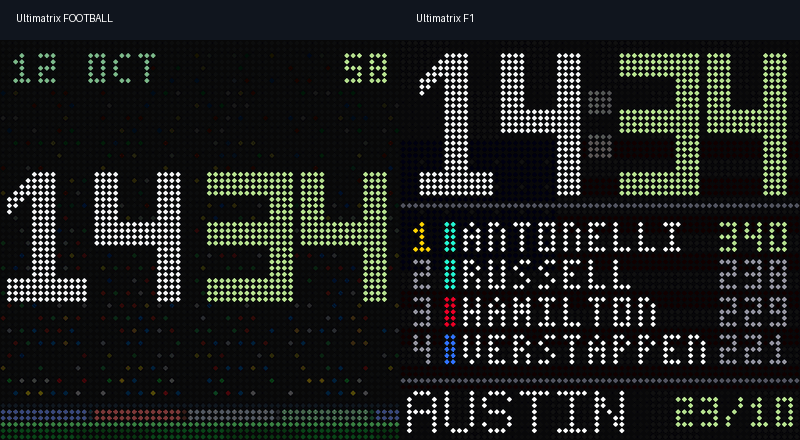

# Ultimatrix

**LED Matrix Clock**

A new ESP32 LED matrix clock foundation, starting with our Football, F1, MotoGP and Tetris clocks and a set of calm pixel-art faces.
The rebuild keeps their displays familiar while improving the internal structure.



## Current baseline

- Separate **Football**, **F1**, **MotoGP** and **Tetris** firmware builds for 64×64 HUB75 panels, and four calm
  pixel-art faces that need no feed: **Words** (the time in words, 16 languages), **Mario** (question blocks, a walking
  Mario, stomped Goombas, and World 1-2 underground at night), **Luigi** (a haunted garden with a shy Boo) and **Pac-Man**
  (the time in pellets above a self-playing maze: a new random, arcade-style maze each level, four ghosts with the arcade targeting).
- New startup flow, Wi-Fi setup, local settings page, and Ultimatrix identity.
- Existing live feeds, sports displays, standings, and Football celebrations ported
  into their own modules.
- Shared time, layout, font assets, download scheduling, and cache mount policy.
- Native recorded-feed previews using the actual drawing code.

This is the first migration stage, not a completed rewrite. See
[architecture and remaining work](docs/ARCHITECTURE.md).

## Build

ESP-IDF 5.5.5 with Arduino ESP32 as a component. One image per mode, from `firmware/`
using the project-local SDK and build wrapper:

```sh
./tools/setup-idf.sh  # first setup only; requires Git, Python, CMake and Ninja
./tools/idf.sh football build
./tools/idf.sh f1 build
./tools/idf.sh tetris build
./tools/idf.sh motogp build
./tools/idf.sh word build   # or mario, luigi, pacman
```

Each build produces `build/<mode>/ultimatrix.bin`. Each mode retains its own
SDK settings and build directory. The wrapper preserves existing configurations
when equivalent Python paths differ only in their spelling. To tune memory,
run `./tools/idf.sh football menuconfig` (or another mode).

`sdkconfig.defaults` supplies defaults for new configurations. Changing it does
not override values already saved in `build/<mode>/sdkconfig`. Inspect the
selected mode's generated configuration before comparing memory measurements.

## Setup

On first start, connect to the **UM-SETUP** Wi-Fi access point and configure the
network in its portal. Once connected, open `http://ultimatrix.local/` or the
IP address printed on USB serial at 115200 baud. Save settings to restart the clock.
The default timezone is Europe/Amsterdam. Settings are stored separately from
previous firmware; they are not imported automatically.

Football defaults to Eredivisie and KNVB Cup, with the Dutch national team as a
favourite. Choose competitions and F1 drivers by name on the local settings page.
Football favourite teams currently use the existing `id:abbreviation:c|n` format;
a team picker is still planned. These selections do not require API credentials.

## Settings page

The local page groups display, time, clock mode, network, and advanced controls.
It works on phones, searches competitions/timezones, and reports validation and
save/restart progress inline. **Change Wi-Fi** restarts into provisioning without
clearing the saved network. The Wi-Fi portal shares the page's visual theme.
Assets are served from firmware flash, with no external fonts or scripts.

## Boot screens, mDNS and telnet

All three modes share the boot screens (`lib/core/BootScreen.*`): the logo fades in, then Wi-Fi connecting and
time sync with pulsing dots, the connected address, and a red pulsing error if the time does not sync within 45 s.
Nothing blinks; it eases through a sine table, and the panel is redrawn only when the picture changes.
In access-point setup mode the panel shows a QR code that joins the open **Ultimatrix** network
(`WIFI:T:nopass;S:Ultimatrix;;`), with the SSID and the portal address (192.168.4.1) fading in turn below it.
The clock is also reachable as `ultimatrix.local` (mDNS, `_http._tcp`), set up again after every Wi-Fi reconnect.

The **telnet console** (port 23, one client at a time) is switched on in the settings page and is **off by default**.
It has no password and no encryption: anyone on your local network can use it, so enable it only on a network you trust.
Commands: `help`, `status`, `heap`, `reboot`, `quit`. Football adds `goal`, `yellow`, `red`, `sub`, `sim`, `next`;
F1 and MotoGP add `sim` and `next`; the other faces have no test commands. Try it with `telnet ultimatrix.local` or `nc ultimatrix.local 23`.

## Previews

Previews use the pinned graphics source in `firmware/vendor/gfx`; no firmware
build is required. Use a C++ compiler and Python with Pillow installed, then run:

```sh
python3 firmware/tools/preview/showcase.py --out docs/previews
```

The pixel-art faces have their own replay (`python3 firmware/tools/preview/faces.py`, one GIF each for Words, Mario, Luigi
and Pac-Man; Mario's replay includes the underground night). The MotoGP preview replays a weekend recorded from the results
API (`firmware/tools/preview/motogp-snapshot.py` records another; `showcase.py --face motogp` renders it).

The recorded replay inputs are in `firmware/tools/preview/showcase-data.json`.
Generated [Football](docs/previews/football.gif), [F1](docs/previews/f1.gif), [Tetris](docs/previews/tetris.gif) and [boot screens](docs/previews/boot.gif)
[MotoGP](docs/previews/motogp.gif), [Words](docs/previews/word.gif), [Mario](docs/previews/mario.gif), [Luigi](docs/previews/luigi.gif) and [Pac-Man](docs/previews/pacman.gif)
animations replay those inputs (the Football and F1 ones recorded sporting results, not current ones; the Tetris one a fixed clock).

## Status and licences

All eight modes compile and their native previews render. Claude's initial
Football device checks covered boot, network connection, feed access, settings
persistence, mDNS, telnet responsiveness and timeout, and a short heap soak.
Visual panel checks, AP provisioning, busy live matches, longer memory soaks,
and F1/MotoGP/Tetris/Words/Mario/Luigi/Pac-Man device operation remain open. See `HANDOFF.txt` for evidence and limits.
No unit tests were added or run.

Retain applicable copyright and dependency notices for reused code and assets.
See [licence scope](LICENSE_SCOPE.md) and [third-party notices](THIRD_PARTY_NOTICES.md).
Name, domain, and trademark availability have not been verified.
