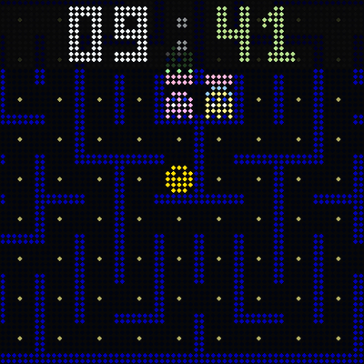

# Ultimatrix

Ultimatrix is an LED matrix clock for an ESP32 and a 64×64 HUB75 panel. It can show live sports, build the time from falling Tetris blocks, spell it out in words, or run an animated Mario, Luigi or Pac-Man scene.

Ultimatrix is inspired by the original [Clockwise](https://github.com/jnthas/clockwise) project by Jonathan Thas. Thank you for the idea and the groundwork.

There are eight clock faces. Each has its own firmware image, so the clock runs one face at a time. You can switch faces from the local settings page by installing another signed image over Wi-Fi.

## Clock faces

| Preview | Face | Build name | What it shows |
| --- | --- | --- | --- |
|  | Football | `football` | Live scores, fixtures, results, league tables and goal celebrations. Choose up to 10 competitions and 8 favourite teams. |
|  | Formula 1 | `f1` | Race weekends, session results, standings and live timing. Favourite drivers get priority on race screens. |
|  | MotoGP | `motogp` | Race weekends, results, standings and live timing, using the same display layout as F1. |
|  | Tetris | `tetris` | Falling pieces that form the time and date. |
|  | Words | `word` | The time in 16 languages, with a weekday, date and minute bar. Choose letter shuffle, letter lift, pixel dissolve, soft wipe, all four in rotation, or no transition. |
|  | Mario | `mario` | Mario walks through scrolling worlds, jumps over pipes and ledges, and collects coins, 1-UP mushrooms and stars. Fixed clock blocks update when he hits them. A flagpole, castle and fireworks scene plays at noon. |
|  | Luigi | `luigi` | The same scrolling worlds and fixed clock blocks, with a taller Luigi, flutter jumps, a Subcon jar and a Shy Guy. He collects items and has the same noon finale. |
|  | Pac-Man | `pacman` | A game that plays itself, with a new maze each level and four ghosts. The clock sits over a dimmed part of the maze. Clock, border, dots and each ghost have separate colour choices. |

Football starts with Eredivisie and KNVB Cup selected, and the Dutch national team as a favourite. Competitions are grouped by country, and favourite teams have a searchable picker.

Mario and Luigi can rotate to a different world each hour, stay in one world, or cycle through them in demo mode. The worlds are Overground, Underground, Castle, Snow, Underwater, Cloud top, Ghost house, Lava and Airship.

Both characters walk automatically, with occasional running bursts at twice the walking speed. The ground and nearby objects scroll faster than distant scenery. They jump over pipes, Piranha Plants and ledges, and collect items along a repeating course. Coins add to the counter, mushrooms show a 1-UP, and stars flash the character's colours. High jumps use tucked, forward-facing legs and pass in front of the fixed clock blocks. Scene animations run 20% faster at about 30 frames per second.

Before a minute change, the character walks under the minute block and pauses briefly before jumping. At an hour change, the minute block is hit first, then the hour block. After landing, the character walks off to the right. A quick swipe brings in the next world, and the character enters from the left. A pinned world uses the same walk-out sequence and keeps the selected world. Each minute hit releases either a green 1-UP or a red Super Mushroom. It slides off the block, falls to the ground and travels toward the character for pickup. After landing, the character keeps walking forward at the usual pace while the camera catches up smoothly and brings them back to the middle of the screen.

## Hardware

The current target is a classic ESP32 Dev Module with 4 MiB of flash and one 64×64 HUB75 panel. The default wiring is:

| HUB75 signals | ESP32 GPIOs, in the same order |
| --- | --- |
| R1, G1, B1 | 25, 26, 27 |
| R2, G2, B2 | 14, 12, 13 |
| A, B, C, D, E | 23, 19, 5, 17, 18 |
| CLK, LAT, OE | 16, 4, 15 |

You can change the display orientation and swap blue and green in settings. Automatic brightness needs a light sensor; its default pin is GPIO 35.

64×32 panels and other ESP32 variants are not current build targets.

## Build and install

The firmware uses ESP-IDF 5.5.5 with Arduino ESP32 3.3.12 as a component. Install Git, Python, CMake and Ninja, then run these commands from the repository root:

```sh
cd firmware
./tools/setup-idf.sh  # first setup only
./tools/idf.sh football build
```

Replace `football` with any build name in the table above. Each image is written to `firmware/build/<mode>/ultimatrix.bin`, with a separate build directory and SDK configuration for each mode.

For a first USB install, stay in `firmware/` and replace `PORT` with your board's serial port:

```sh
./tools/idf.sh football -p PORT flash
./tools/idf.sh football -p PORT monitor
```

Serial output runs at 115200 baud. If the clock already has the Ultimatrix bootloader and partition table, `app-flash` writes just the application.

To change SDK settings, run `./tools/idf.sh football menuconfig`. `sdkconfig.defaults` supplies defaults for new builds; it does not overwrite a mode's saved `build/<mode>/sdkconfig`.

### Browser install

A USB browser flasher is included in [web-flasher/](web-flasher/index.html). Build the faces you want, then generate its images from `firmware/`:

```sh
./tools/build-webflasher.sh football f1
```

This writes a full flash image and a manifest for each built face into `web-flasher/firmware/`. From the repository root, you can serve the page locally:

```sh
python3 -m http.server 8000 --directory web-flasher
```

Open [localhost:8000](http://localhost:8000/) in a desktop browser with Web Serial support, such as Chrome or Edge. A hosted flasher needs HTTPS. Use a USB cable that carries data.

The flasher offers to erase the device on a fresh install. Erasing removes Wi-Fi credentials and settings; leave that option off if you want to keep them.

The hosted flasher is at [vandalon.github.io/ultimatrix](https://vandalon.github.io/ultimatrix/) once a release has been published; signed update files are mirrored under [/updates/](https://vandalon.github.io/ultimatrix/updates/).

## First setup

1. Power on the clock. Join the open **UM-SETUP** Wi-Fi network, or scan the QR code on the panel.
2. Open [192.168.4.1](http://192.168.4.1/) if your phone does not open the setup portal. Choose your Wi-Fi network and enter its password.
3. After the clock restarts, reconnect your phone to your normal Wi-Fi. Open [ultimatrix.local](http://ultimatrix.local/) or the IP address shown on the panel and in the serial log.
4. On the first setup, the clock stays on its welcome screens until you press **Start the clock** on the settings page. It then restarts into the selected face.

If `ultimatrix.local` does not open on your device, use the IP address. It can change when your router assigns a new one.

The clock detects its timezone and approximate location from the network's public IP address. You can choose the timezone yourself. Europe/Amsterdam is the initial default if no location has been detected. Time is synced through NTP.

Your settings stay saved across restarts.

## Settings

Open the clock's address from a phone or computer on the same network. Most changes save automatically and apply while the clock runs. Swapping blue and green needs **Save & restart**. Changing Wi-Fi or installing a face also restarts the clock.

The page has controls for brightness, rotation, time format, timezone, time server and the current face. Sports faces add page timing and favourites. Words adds language and transition choices. Mario and Luigi add the world picker. Pac-Man adds its colour controls; the default clock colour keeps off-white hours and green minutes.

The page and its assets are stored in firmware flash. A new setting only appears after installing firmware that contains it. If an updated page still looks old, reload it without using the browser cache.

**Change Wi-Fi** opens provisioning again. The saved network stays available until you choose another one.

### Brightness and night display

Brightness can be fixed or follow a light sensor. With automatic brightness enabled, use the live sensor reading to set the dark and bright limits. Readings are averaged, and small changes are ignored to reduce flicker.

Most faces can switch to a dim numeric clock during chosen hours, from sunset to sunrise, or when the sensor detects a dark room. It is dark red by default. Pac-Man uses the border colour for its night clock.

Mario and Luigi handle night differently. Their scenes follow sunset and sunrise at the detected location, with stars and a moon in outdoor scenes. Hourly rotation skips Snow, Underwater, Cloud top and Airship at night; pinned worlds and demo mode keep your choice. Their scenes do not use the night schedule. A dark room, detected by the light sensor, switches them to the dim numeric clock.

Changes tied to sunrise and sunset need a detected location. Automatic brightness and the night schedule are off by default.

## Updates and switching faces

The clock checks for updates at startup when its cached check is missing or more than 12 hours old, then about every 12 hours while running. Checking does not install anything. During installation, Mario and Luigi stand still and show "Updating..." instead of the date and coin count. Their scene resumes if installation fails. Available updates appear on the boot screen and settings page; installation starts when you choose it.

In **Advanced**, use **Check for updates** or **Install update**. The face picker installs another face using the same update system. The clock refuses updates while live sports data is active. If there is too little memory, the page can offer a restart before installation.

Images need a signed manifest and a matching checksum. The updater rejects releases already installed or superseded for that face and update source. Boot rollback is enabled, with startup health checks before a new image is confirmed; failure recovery still needs device checks.

### Update source

You can enter your own base address in **Advanced → Update server**. It must serve `manifest.json`, `manifest.sig` and the image in a folder for each face, for example `<base>/football/`.

Leaving the field empty selects GitHub releases. The repository setting in [UpdateTrust.h](firmware/lib/core/UpdateTrust.h) is still `OWNER/ultimatrix`, so GitHub updates will not work until it is set to a real release repository and the firmware is rebuilt. The included public key must match the key used to sign your releases.

For your own builds, the packaging script uses Python's `cryptography` package and the private signing key at `.tools/update-signing.pem`. After building, run this from the repository root:

```sh
python3 firmware/tools/package-firmware.py
```

It writes the built faces and signed manifests to `dist/firmware/`, in the folder layout expected by a private server. Keep the signing key private. Self-hosted face installation has been confirmed on a device.

The [release workflow](.github/workflows/release.yml) builds all eight faces when a `v*` tag is pushed. It signs the update manifests, creates a GitHub release and deploys the browser flasher and an update-file mirror to GitHub Pages. It needs the `UPDATE_SIGNING_KEY` repository secret and GitHub Pages configured for Actions. This workflow has not yet been checked end to end.

## Remote console

The telnet console is off by default. Enable **Remote console** in settings, then connect on port 23:

```sh
telnet ultimatrix.local
```

It accepts one client at a time and has no password or encryption. Enable it only on a network you trust.

Use `help` for the available commands. Shared commands include `status`, `heap`, `log on`, `log off`, `reboot`, `update`, `update-status` and `quit`. Arrow-key history and tab completion are supported; `q` or Ctrl-D on an empty line closes the session.

Mario and Luigi add `world list` and `world <name>`. F1 and MotoGP add `sim` and `next`. Football's simulated match controls have been removed.

`factory-reset yes` erases Wi-Fi credentials, settings, cached data and update history, then restarts into setup.

## Previews

Native previews compile the actual drawing code with hardware replacements. They need a C++17 compiler and Python with Pillow, but no ESP-IDF build or connected clock.

From the repository root:

```sh
python3 firmware/tools/preview/refresh.py
```

This refreshes all eight face images, their animated previews, the overview and the boot replay. The README uses the same PNG files as the settings page. Rebuild and install the firmware to put new images on a clock.

For one animated preview, use `--face football` with `showcase.py`, or `--face pacman` with `faces.py`. The sports previews replay data from `firmware/tools/preview/showcase-data.json`; they show recorded results rather than current feeds. Tetris uses a fixed clock, and the other animated faces use scripted clock scenarios.

Browse the saved previews: [Football](docs/previews/football.gif), [F1](docs/previews/f1.gif), [MotoGP](docs/previews/motogp.gif), [Tetris](docs/previews/tetris.gif), [Words](docs/previews/word.gif), [Mario](docs/previews/mario.gif), [Luigi](docs/previews/luigi.gif), [Pac-Man](docs/previews/pacman.gif) and [boot screens](docs/previews/boot.gif). More recent examples cover [Words transitions](docs/previews/word-transitions.gif) and [Pac-Man clock colours](docs/previews/pacman-clock-colours.png).

The complete hour-change sequences have separate previews: [Mario](docs/previews/mario-hour.gif) and [Luigi](docs/previews/luigi-hour.gif).

These images were rendered from the current code on 14 October 2026. They help review the drawing; they do not establish how it looks or behaves on a real panel.

## Development status

As of 14 October 2026, the firmware builds with ESP-IDF and Arduino as a component. The shared runtime, local setup and settings, brightness controls, night display, signed updater and eight faces are implemented. The drawing and feed code are still being cleaned up.

All eight faces have successful builds recorded during development. That does not mean the latest source has been rebuilt for every face. The recent Words transitions and Pac-Man changes have been checked in native previews and browser mocks; the latest Pac-Man clock-colour change has not had a firmware build or device check.

The latest Mario and Luigi walking poses, pipes, jumps and hour-change sequences have been checked in native previews. This revision has not had a firmware build or panel check.

Football has had initial device checks for boot, Wi-Fi, feeds, saved settings, mDNS and telnet. F1 has had a short device check of memory use and update checking.

Still open: busy live matches, longer memory runs, the latest animations and colours on a panel, setup QR reliability across phones, update failure recovery, and the GitHub release/browser install path.

## Licences

Licences vary across the project. See [licence scope](LICENSE_SCOPE.md) and [third-party notices](THIRD_PARTY_NOTICES.md) for the terms that apply to each part. Keep the required copyright and dependency notices when reusing code.

This is an unofficial fan project. The character names belong to their owners. Name, domain and trademark availability have not been verified.
