# Ultimatrix

<p>
  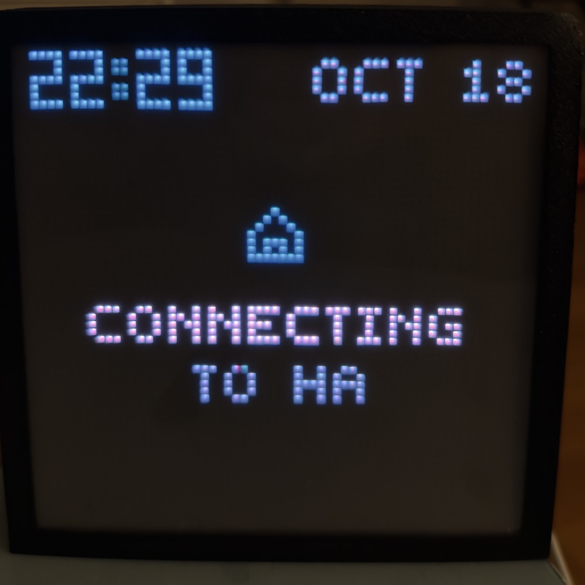
  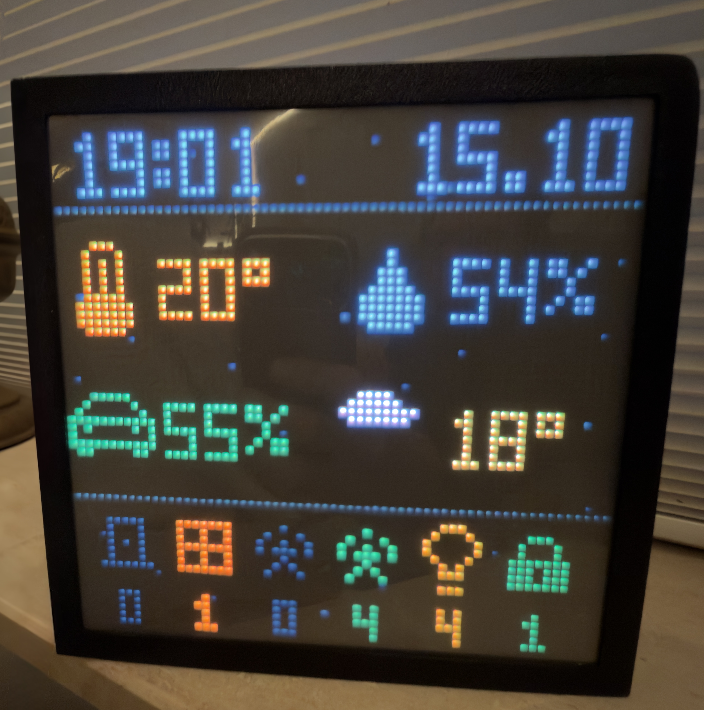
  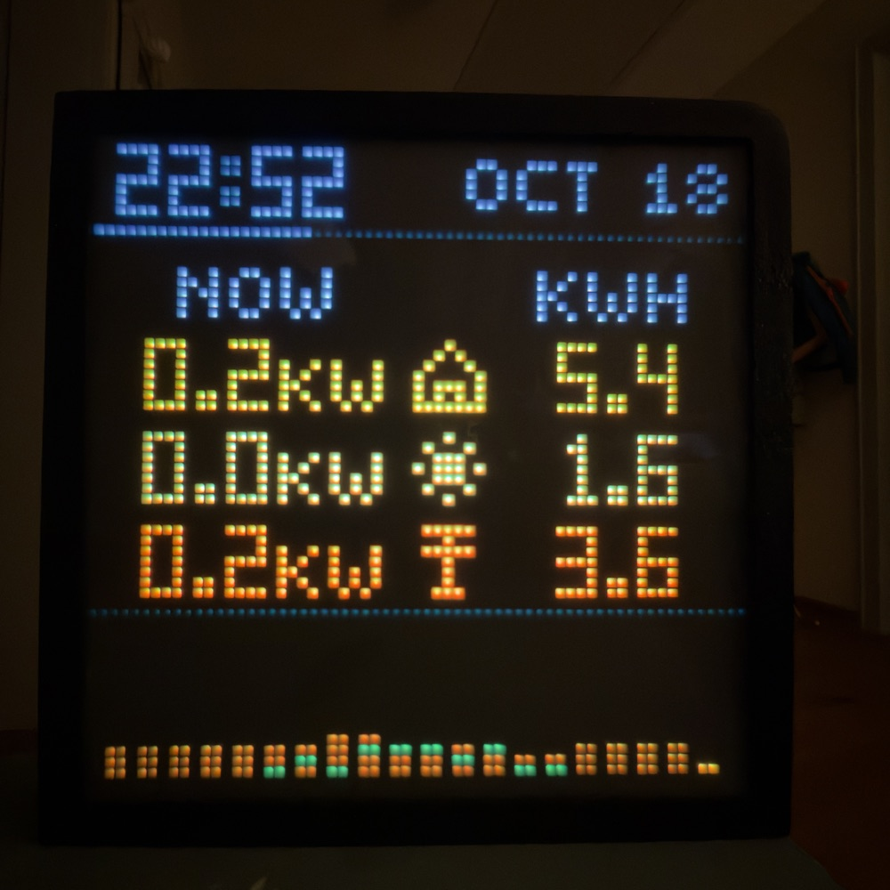
  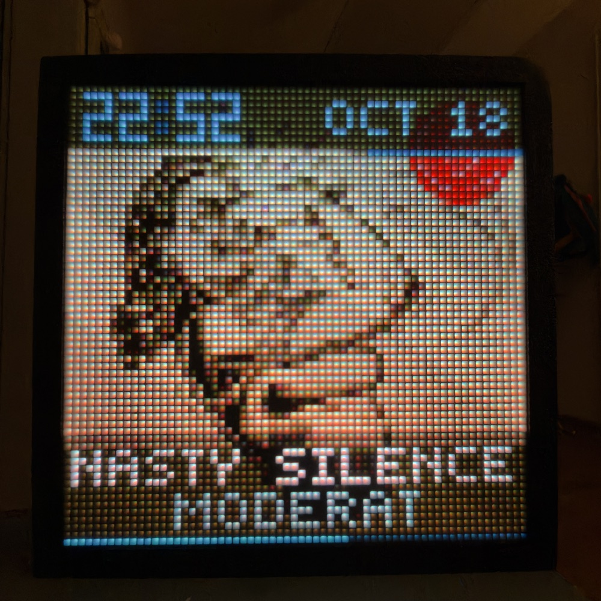
</p>

Ultimatrix is an LED matrix clock for an ESP32 and a 64×64 HUB75 panel. It can show live sports, build the time from falling Tetris blocks, spell it out in words, or run an animated Mario, Luigi or Pac-Man scene, or play Space Invaders or Pong while it tells the time.

Ultimatrix is inspired by the original [Clockwise](https://github.com/jnthas/clockwise) project by Jonathan Thas. Thank you for the idea and the groundwork.

The HUB75 panel driver is a memory-optimised fork of [ESP32-HUB75-MatrixPanel-DMA](https://github.com/mrcodetastic/ESP32-HUB75-MatrixPanel-DMA), published separately as [ESP32-HUB75-DMA-Memory-Optimized](https://github.com/vandalon/ESP32-HUB75-DMA-Memory-Optimized).

Start with the [hardware setup guide](docs/HARDWARE.md), then [install from your browser](https://vandalon.github.io/ultimatrix/) (Chrome or Edge, USB cable that carries data). Details: [Install](#install).

There are eleven clock faces. Each has its own firmware image, so the clock runs one face at a time. You can switch faces from the local settings page by installing another signed image over Wi-Fi.

## Clock faces

| Preview | Face | Build name | What it shows |
| --- | --- | --- | --- |
| 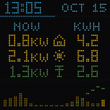 | Home | `home` | The clock with Home Assistant beside it: an Energy page, the one it starts on (house, solar or battery, and grid, now and today, with the last 20 hours), and a Home page (temperature, humidity, who is home, and icons for doors, windows, garage, washer, lights and the alarm). Alerts for the doorbell, a finished washer, a door left open and the alarm. It connects to Home Assistant over its WebSocket API with a long-lived access token, set up on the settings page. |
| 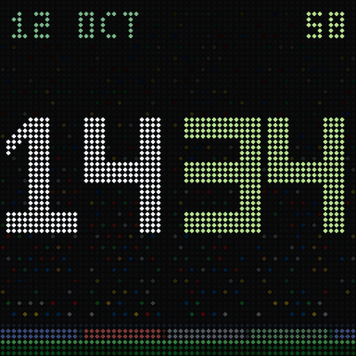 | Football | `football` | Live scores, fixtures, results, league tables and goal celebrations. Choose up to 10 competitions and 8 favourite teams. |
| 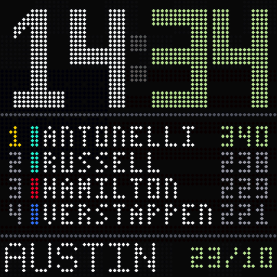 | Formula 1 | `f1` | Race weekends, session results, standings and live timing. Favourite drivers get priority on race screens. |
| 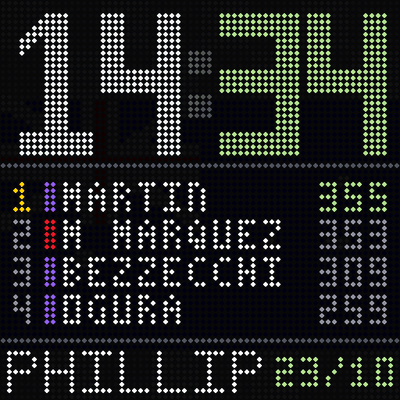 | MotoGP | `motogp` | Race weekends, results, standings and live timing, using the same display layout as F1. |
| 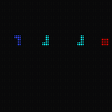 | Tetris | `tetris` | Falling pieces that form the time and date. |
| 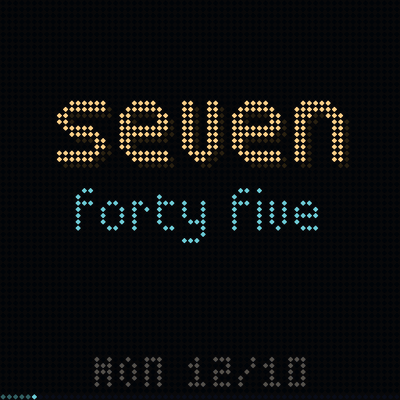 | Words | `word` | The time in 16 languages, with a weekday, date and minute bar. Choose letter shuffle, letter lift, pixel dissolve, soft wipe, all four in rotation, or no transition. |
| 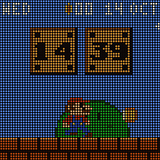 | Mario | `mario` | Mario in scrolling worlds, with clock blocks showing the time. |
| 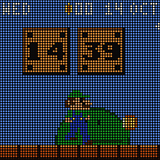 | Luigi | `luigi` | A Luigi version of the scrolling-world clock. |
| 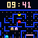 | Pac-Man | `pacman` | A game that plays itself in a maze of 8 by 7 lanes with the clock box in the middle: the level top left, the score bottom left, the spare lives bottom right and the time on the right. It has a score (10 a dot, 50 a power pellet, 200 and doubling for the ghosts) and a life more every 6000 points, up to three spares. Four ghosts wait in the box, which dims whatever they sit over, and leave through its floor. Every level gets a new maze that is as different from the last as it can be. Pac-Man plays like a novice, casual, good or expert player, picked for each new game. You can take over from the settings page (see [Playing Pac-Man yourself](#playing-pac-man-yourself)). Border, dots, hours and minutes colour and each ghost have colour choices. |
| 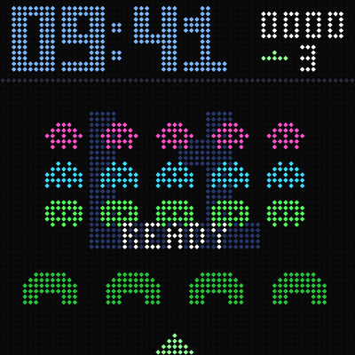 | Space Invaders | `invaders` | A game that plays itself: five columns of squids, crabs and octopuses in three rows march down towards four shields that crumble, bombs fall, and the cannon dodges and shoots. The time is along the top, with the score and your spare cannons (up to four) stacked on its right. While the computer plays, the date is the backdrop (the day number with the weekday and month beside it) and the field is slightly dimmed; while you play, the backdrop is the level. The mystery ship flies by every minute (a bigger one at the hour; shoot it for 50 to 300 points), waves get faster, and a life more comes every 1500 points. Clock hours, minutes and score have colour choices. You can take over from the settings page (see [Playing Space Invaders and Pong yourself](#playing-space-invaders-and-pong-yourself)). |
| 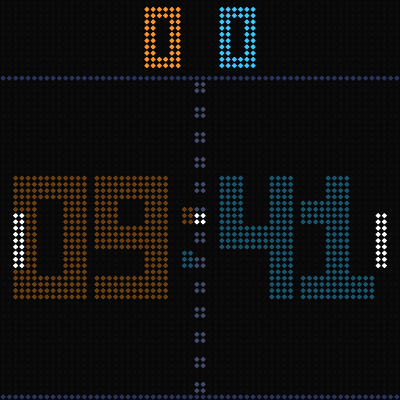 | Pong | `pong` | The time is a big background clock behind the court (hours in the left player's colour, minutes in the right player's) with the score on top and optional weekday and date above or below it. The two computer players rally, and when the minute turns the left one lets the ball go by so the right one scores and the minute changes (at the hour the right one lets it go, so the left one scores and the hour changes). Nine difficulty levels, a game speed, the brightness of the background clock and the colours are settings. You can take the left paddle yourself from the settings page: a match goes to 7 and then the computers take over again. |

Football starts with Eredivisie and KNVB Cup selected, and the Dutch national team as a favourite. Competitions are grouped by country, and favourite teams have a searchable picker.

### Playing Space Invaders and Pong yourself

Both games play themselves and keep the time. To take over, open the clock's settings page while the face is running and open the **full-screen touch controller** under **Play yourself**. The controller sends your moves over a WebSocket, and the clock pauses notices, update checks and the live preview while you play. The clock plays again after 20 seconds without a move, or when you press **Computer**; the game restarts whenever control changes hands.

- **Space Invaders**: swipe left and right anywhere to move the cannon (like Pong's dial, but sideways), and every touch fires, so a second finger can fire while the first steers. The arrow keys or A D move and the space bar fires. A life more comes at every 1500 points, up to four.
- **Pong**: you play the left paddle against the computer; swipe up and down anywhere to turn the dial like the original game. The labels show YOU and CMP, the score shows the match (first to 7) and afterwards the computers take over again.

Controller sensitivity is a slider in the settings page, and Pong has a difficulty from 1 to 9.

## Home Assistant

The `home` face needs Home Assistant on the same network (or reachable from it).

1. In Home Assistant open your profile, Security, and create a long-lived access token.
2. Switch the clock to the Home face (settings page, Clock face), open its settings page and fill in the Home Assistant card: address (for example `homeassistant.local:8123`) and the token. The clock keeps the token and never shows it again.
3. Choose the pages (the Energy page comes first; it is left out until you enter its entities) and what each tile and icon shows. Every slot detects its entities by itself while its entity field is empty (all door sensors, all lights, the average temperature and so on, shown as grey tags; the refresh button detects again). Remove a grey tag, or type an entity or group, to use your own list instead. The energy rows use the entity IDs of your power and energy sensors.

The Home page has up to six configurable tiles, spread evenly over the panel. Each can show temperature, humidity, people home, power, a custom number, CO₂, rain, EV charge, energy price, outdoor humidity, weather, or nothing. Defaults are indoor temperature, indoor humidity, EV charge and weather. EV charge is one tile with three entities, all detected when left empty: the charge (battery percentage), whether the car is charging and whether it is plugged in. The car icon is the same green in every state and gets a bolt while charging and a plug while plugged in; CO₂ and rain also need a sensor; energy price, when empty, uses the Energy dashboard’s grid tariff. CO₂ is shown in ppm; rain and price use the sensor’s numeric value without conversion or a unit suffix.

Weather follows the current condition and temperature of a `weather.*` entity. When empty, the first available weather entity is used, and Outdoor humidity reads its humidity. Choose an entity to use a specific weather entity or outdoor humidity sensor. Counts appear below the state icons, and the clock colon gently breathes over three seconds. Both data pages use a plain black background. The default bottom bar shows low batteries, offline devices, water leaks, open blinds, playing media and active heating; each slot remains configurable. Low batteries includes percentage sensors at 20% or less and low-battery binary sensors, deduplicated by device. Offline counts devices with unavailable entities; entities without an assigned device count separately. Blinds includes blinds, curtains, shades and shutters that are not closed. Heating counts climate entities whose current action is heating. Choose an entity or group instead of the detected ones to limit a count. For Lights, the detected lights count individually; with your own selection, lights that are on are counted once per Home Assistant area. Lights without an area are excluded from this room count. Occupied rooms counts distinct Home Assistant areas with active motion, occupancy or presence sensors; assign sensors to areas to include them. Washer-done popups have their own Washer running field under Alerts and work without a visible washer icon. Existing fourth-slot washer settings move there automatically.

The optional Now playing page shows the title and artist over a full-panel album cover for the first of the media players you pick (up to four, with suggestions as you type) that is playing. It only appears in the rotation while one is playing, and long titles scroll. The cover comes from the player's picture through Home Assistant (JPEG only; other pictures, or none, show a music note), so it needs the same access token. It is shown only when the picture is on Home Assistant itself. An option, off by default, also shows that cover dimmed to a quarter of its brightness behind every other page while something plays; it stays still while pages slide.

Entity fields suggest matching entities from Home Assistant as you type. "Fill from Home Assistant" on the Energy page reads the sensors of Home Assistant's own Energy dashboard (grid, solar and battery meters, and power sensors where they exist) into the empty fields; anything you typed stays. Meters that count for ever are fine for the kWh columns: the clock shows their change since midnight, taken from Home Assistant's statistics. For the grid and solar meters it takes the first sensor listed (the import side, and the first tariff).

The clock opens one WebSocket to `/api/websocket`, signs in with the token and subscribes to a single template that Home Assistant renders itself, so it only receives a short line of values whenever they change. Each popup (alarm, doorbell, a finished washer, a door left open) has its own options: also at night (it shows through the night clock and the birthday screen), full brightness while it is up, and flashing the whole panel in its colour. HTTP and HTTPS connections are supported. HTTPS is reported working on the current Home Assistant setup; the certificate is not verified, like the other feeds. Preview the screens with `python3 firmware/tools/preview/home.py` (needs ffmpeg).

## Hardware

Wiring, board pin maps (including the Wemos D1 R32), power and troubleshooting: see the [hardware setup guide](docs/HARDWARE.md).

The current target is a classic ESP32 Dev Module with 4 MiB of flash and one 64×64 HUB75 panel. The default wiring is:

| HUB75 signals | ESP32 GPIOs, in the same order |
| --- | --- |
| R1, G1, B1 | 25, 26, 27 |
| R2, G2, B2 | 14, 12, 13 |
| A, B, C, D, E | 23, 19, 5, 17, 18 |
| CLK, LAT, OE | 16, 4, 15 |

You can change the display orientation and swap blue and green in settings. Automatic brightness needs a light sensor; its default pin is GPIO 35.

64×32 panels and other ESP32 variants are not current build targets.

## Install

<p>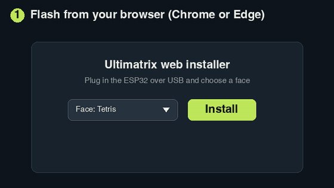<br><em>Illustrated quick start (drawn from the real screens, not a recording).</em></p>

### Install from your browser

The easiest way to flash a clock is the browser installer at **[vandalon.github.io/ultimatrix](https://vandalon.github.io/ultimatrix/)**. No tools are needed.

1. Wire the panel first: see the [hardware setup guide](docs/HARDWARE.md).
2. Connect the ESP32 to your computer with a USB cable that carries data.
3. Open the installer in Chrome or Edge on a desktop (they support Web Serial), choose a face and click Install.
4. Leave the erase option off to keep Wi-Fi credentials and settings; turn it on for a fresh start.
5. Follow [First setup](#first-setup) once it restarts.

Signed update files are mirrored under [/updates/](https://vandalon.github.io/ultimatrix/updates/). After the first install you can update and switch faces over Wi-Fi.

### Build from source

The firmware uses ESP-IDF 5.5.5 with Arduino ESP32 3.3.12 as a component. Install Git, Python, CMake and Ninja, then run these commands from the repository root:

```sh
cd firmware
./tools/setup-idf.sh  # first setup only
./tools/idf.sh football build
```

Replace `football` with any build name in the table above. Each image is written to `firmware/build/<mode>/ultimatrix.bin`, with a separate build directory and SDK configuration for each mode.

For a first USB install, stay in `firmware/` and replace `PORT` with your board's serial port:

```sh
./tools/idf.sh football -p PORT flash
./tools/idf.sh football -p PORT monitor
```

Serial output runs at 115200 baud. If the clock already has the Ultimatrix bootloader and partition table, `app-flash` writes just the application and also erases the boot selection, so the clock boots the image you just flashed even after an over-the-air install (set `UM_KEEP_OTADATA=1` to skip the erase).

To change SDK settings, run `./tools/idf.sh football menuconfig`. `sdkconfig.defaults` supplies defaults for new builds; it does not overwrite a mode's saved `build/<mode>/sdkconfig`.

### Host the browser flasher yourself

The installer above is the page in [web-flasher/](web-flasher/index.html). To run it locally with your own builds, generate its images from `firmware/`:

```sh
./tools/build-webflasher.sh football f1
```

This writes a full flash image and a manifest for each built face into `web-flasher/firmware/`. From the repository root, you can serve the page locally:

```sh
python3 -m http.server 8000 --directory web-flasher
```

Open [localhost:8000](http://localhost:8000/) in Chrome or Edge on a desktop. A flasher hosted elsewhere needs HTTPS.

## First setup

1. Power on the clock. Join the open **UM-SETUP** Wi-Fi network, or scan the QR code on the panel.
2. Open [192.168.4.1](http://192.168.4.1/) if your phone does not open the setup portal. Choose your Wi-Fi network and enter its password.
3. After the clock restarts, reconnect your phone to your normal Wi-Fi. Open [ultimatrix.local](http://ultimatrix.local/) or the IP address shown on the panel and in the serial log.
4. On the first setup, the clock stays on its welcome screens until you press **Start the clock** on the settings page. It then restarts into the selected face.

If `ultimatrix.local` does not open on your device, use the IP address. It can change when your router assigns a new one.

The clock detects its timezone and approximate location from the network's public IP address. You can choose the timezone yourself. Europe/Amsterdam is the initial default if no location has been detected. Time is synced through NTP.

Your settings stay saved across restarts.

## Settings

Set **Network → Clock name** to identify each clock in MQTT and WLED, for example “Living room clock”. The name is saved across restarts and face changes and defaults to “Ultimatrix”. Renaming updates MQTT discovery and the WLED API immediately; device IDs and MQTT topics stay the same. **Use clock name for network address** is off by default. When enabled, “Living room clock” becomes `living-room-clock.local` (lowercase letters/numbers with separators replaced by hyphens; a name with no usable letters/numbers falls back to `ultimatrix`). With it off, a lone clock uses `ultimatrix.local`. When clocks detect another Ultimatrix on the network, each adds the last three MAC bytes, for example `ultimatrix-abff01.local` or `living-room-clock-abff01.local`. The suffix stays until restart. Peer detection needs this firmware on the clocks and working multicast on the LAN. The current address is shown under Network; a page opened by its old `.local` name moves to the IP address after a rename.

Open the clock's address from a phone or computer on the same network. Most changes save automatically and apply while the clock runs. Swapping blue and green needs **Save & restart**. Changing Wi-Fi or installing a face also restarts the clock.

The page has controls for brightness, rotation, time format, timezone, time server and the current face. Sports faces add page timing and favourites. Words adds language and transition choices. Mario and Luigi add the world picker. Pac-Man adds its colour controls (the clock is yellow by default) and the Play yourself card.

The page and its assets are stored in firmware flash. A new setting only appears after installing firmware that contains it. If an updated page still looks old, reload it without using the browser cache.

**Admin PIN** (Advanced) is optional and also asked once during the first Wi-Fi setup. With a PIN set, the settings page asks for it before it changes anything; everything WLED (the apps, Home Assistant's WLED link, presets, timers, backup and the drawing editor with saving) keeps working without it. If you forget it, flash the clock again.

**Who may open the clock** (Advanced) limits the settings pages, the APIs (including Home Assistant and the WLED app) and the telnet console to **private networks** (10.x, 172.16-31.x, 192.168.x; the default), **only the clock's own network**, or **everything that can reach it**. If the clock sits on a network with public addresses (some universities), private-only allows everything. Saving a choice that would lock out the computer you save from is refused. **Allow public host names** is off by default: the clock then refuses requests that arrive under a public domain name (a name under a real top-level domain), which stops a web page on the internet from steering your browser at the clock (DNS rebinding). Addresses, `.local`, `fritz.box` and internal names such as `joris.panel` keep working. Turn it on only if you reach the clock through a public name, for example a reverse proxy.

**Change Wi-Fi** opens provisioning again. The saved network stays available until you choose another one.

### Brightness and night display

Brightness can be fixed or follow a light sensor. With automatic brightness enabled, the panel dims to the minimum brightness, and the night clock comes on, when the sensor reads dark and also during the night hours or from sunset to sunrise, if you set those (switch the night clock off to keep the face up while it dims); use the live sensor reading to set the dark and bright limits. Readings are averaged, and small changes are ignored to reduce flicker.

Most faces can switch to a dim numeric clock during chosen hours, from sunset to sunrise, or when the sensor detects a dark room. These work together, also with automatic brightness on. It is dark red by default. Pac-Man uses the border colour for its night clock.

Mario and Luigi scenes follow sunrise and sunset rather than the night schedule. A dark room can switch them to the dim numeric clock.

Changes tied to sunrise and sunset need a detected location. Automatic brightness and the night schedule are off by default.

### Playing Pac-Man yourself

With the Pac-Man face, the Clock mode card on the settings page has a **Play yourself** card. Any move takes over from the computer; Pac-Man keeps going and takes your turn at the next crossing. The clock plays again after 20 seconds without a move, or at once when you press **AI**.

- **Keys:** arrow keys or W A S D.
- **Touch:** **Open full-screen controller** fills the screen. Put a finger down anywhere and drag: a joystick appears under your finger and follows it, so the direction is simply the way your finger moves. Letting go keeps Pac-Man going. Android phones vibrate briefly; iPhones do not give feedback while dragging.
- **A game controller on your phone or computer:** pair it with that device (Bluetooth or USB), press a button once so the browser sees it, then use the d-pad or left stick. Start hands control back to the clock. This costs the clock nothing.
- **A Bluetooth LE controller paired with the clock itself (experimental, off by default):** turn **Bluetooth** on in the card (this restarts the clock), press **Pair controller** (the clock restarts into Bluetooth), switch the controller to pairing mode and keep it within a metre or two. A paired controller connects again whenever it is switched on. Only Bluetooth LE controllers work (for example Xbox Series controllers on recent firmware, which I have not tried with this firmware). PlayStation, Switch and most Android gamepads use classic Bluetooth and do not. This part has never been tried with a real controller.

Bluetooth needs about 75 KB of the clock's memory, so it only runs while a controller is paired (or for about 70 seconds after you press Pair); with the setting on and nothing paired, the clock uses no extra memory. While it runs, WLED, Canvas, Animations, DLNA, notifications and the telnet console are switched off; Home Assistant MQTT keeps working. A firmware update restarts the clock first, so the download has the whole memory. Forgetting the controller restarts the clock back to normal.

### Control from Home Assistant (MQTT, optional)

Every face can be controlled from Home Assistant over MQTT. It is off until you switch it on under **Home Assistant (MQTT)** on the settings page: enter the address of your MQTT broker (the Mosquitto add-on, for example) and, if it needs them, a username and password. Home Assistant then discovers the clock as a device with these entities:

- **Brightness**, **Auto brightness** and **Night clock** as controls.
- All the standard settings under the device's configuration: minimum brightness, night mode, night from sunset to sunrise, night start and end (`HH:MM`), display orientation, 24-hour clock, automatic time zone, time zone, time server, the light sensor's dark and bright levels (with a live **Light level** reading, sent every 10 seconds while auto brightness is on, to help set them), swap blue and green (restarts the clock), automatic updates and the remote console. Changes from Home Assistant apply at once and are stored a moment later; changes made on the settings page show up in Home Assistant too. Bad values are ignored.
- **Restart** and **Check for updates** buttons.
- **Firmware**, an update entity: Home Assistant shows when a newer version is available and installs it from the device page or an automation (the clock restarts when it is done, and shows the progress while it downloads). It follows the update source of the settings page.
- **Notification**: a notify entity. Call `notify.send_message` on it (it needs a Home Assistant release with MQTT notify entities) to show a message on the panel, whatever the face. Plain text understands two markers:

  - `Title|message` puts a title above the message (the first 20 characters of the title are shown).
  - A leading `!` makes it high priority.

  ```yaml
  action: notify.send_message
  target:
    entity_id: notify.ultimatrix_notification
  data:
    message: "!Front door|Someone is at the door"
  ```

  For a colour or a display time, publish JSON to `ultimatrix/<id>/notify/set`, for example with the `mqtt.publish` action:

  ```yaml
  action: mqtt.publish
  data:
    topic: ultimatrix/<id>/notify/set
    payload: '{"title": "Front door", "message": "Someone is at the door", "priority": "high", "color": "red", "seconds": 20}'
  ```

  JSON fields: `message` (up to 200 characters), `title`, `color` (a name such as `red` or `#rrggbb`), `seconds` (2 to 300) and `priority` (`normal` or `high`). Each line of message text is centred horizontally; short messages are also centred vertically below the header. Text that does not fit scrolls, and the message stays up long enough to scroll through. A **normal** message shows as plain text for 10 seconds, waits while night mode is on, with or without the night clock (up to an hour) and does not replace an urgent one. A **high** priority message shows at once at full brightness, whatever the hour, blinks like the doorbell on the Home face with a warning sign, and stays 30 seconds. An empty message dismisses what is showing.
  Static JPEG and PNG pictures use the same Notification entity: send a JSON string in its message field. For example, put a baseline JPEG at `/config/www/clock-picture.jpg` on Home Assistant, then send:

  ```yaml
  action: notify.send_message
  target:
    entity_id: notify.ultimatrix_notification
  data:
    message: >-
      {"image":"http://homeassistant.local:8123/local/clock-picture.jpg","seconds":15}
  ```

  To send a picture without hosting it, put the 64×64 RGB565 image in the JSON as `image_rgb565` (10,924 base64 characters, the same format as the [MQTT pixel commands](docs/MQTT_PIXELS.md)), together with the optional `title`, `message`, `priority` and `seconds`. It works on the `notify/set` topic (the whole message is limited to 12 KB, and memory must be free when it arrives), and `firmware/tools/img2base64.py picture.jpg --notify --yaml` builds the complete action from any JPEG or PNG.

  Use your clock's actual entity ID. The `image` field also works with `mqtt.publish` on the existing notification topic. At normal priority, optional `title` and `message` alternate with the picture every three seconds (at least six seconds total so both can be seen). Image-only notifications fill the panel, fitting the picture with black bars to preserve its shape by default. Add `"scale":"fill"` to fill the panel, cropping the centre without stretching; `"scale":"fit"` keeps the whole picture. Normal priority still waits for night mode to end; high priority shows the picture continuously at full brightness, including during night mode, without borders, blinking or text. The duration starts after loading, then the clock returns to its face.

  Pictures can be baseline JPEGs or non-interlaced PNGs, served by an HTTP(S) URL the clock can reach (up to 256 characters). The clock sends no authentication headers and does not follow redirects; a Home Assistant `/local/` URL works without a token.

  - **JPEG** is the format for photos, camera snapshots and anything larger than the panel: up to 2048×2048 pixels and 128 KiB. It is decoded in small blocks and scaled down on the way, so its memory use does not depend on the picture size.
  - **PNG** is meant for small pictures such as icons and pixel art, ideally pre-sized to 64×64. PNG decoding needs the whole decoded image in one block of memory, so large PNGs are refused (the console shows `PNG needs N bytes of decode memory`). Measured on the Home face: a 165×115 RGBA PNG needs about 79 KB and a 512×512 RGBA PNG about 1 MB, while the largest free block is usually under 30 KB. As a rule of thumb, stay below about 60×60 for RGBA, 70×70 for RGB and 120×120 for 8-bit palette PNGs. Larger pictures should be sent as JPEG. Supported: grayscale/palette at 1, 2, 4 or 8 bits and RGB/alpha at 8 bits per channel, with transparency shown against black. Not supported: interlaced, 16-bit and animated PNG.

  Picture downloads wait for available memory and quiet live feeds, and give up after 30 seconds. Failed pictures fall back to the supplied text; an image-only failure leaves the face visible. Images stay in RAM only. HTTPS follows the feeds' existing policy without certificate verification. Sending an empty message dismisses the notification, including its picture.

  To show a doorbell snapshot, use these actions after your automation's doorbell trigger. Replace the camera, notification entity and HA address:

  ```yaml
  actions:
    - action: camera.snapshot
      target:
        entity_id: camera.front_door
      data:
        filename: /config/www/doorbell.jpg
    - action: notify.send_message
      target:
        entity_id: notify.ultimatrix_notification
      data:
        message: >-
          {"image":"http://192.168.1.100:8123/local/doorbell.jpg","scale":"fill","seconds":20,"priority":"high"}
  ```

  This example crops the centre to fill the panel and shows only the image at full brightness for 20 seconds. Omit `scale` to keep the whole picture with black bars.

  Create `/config/www` first and allow HA to write snapshots there. This saves the camera's original image without resizing; it must meet the JPEG limits above. Files in `/config/www` are served under `/local/` without authentication, so use a picture you are comfortable making accessible to anyone who can reach that HA address.

Canvas has a **Download picture** button for the current editor image. It exports a static 64×64 `.bmp`. Upload it in Home Assistant under Media, then pick the clock's media player (the DLNA Digital Media Renderer integration finds it automatically) and use Browse media > Play; the picture stays until Stop. You can also serve the file at a reachable HTTP(S) URL and use it in a notification's `image` field. Animation frames are not exported. A BMP played with Home Assistant's Play media has been checked on a real clock; PNG and JPEG over DLNA have not. Home Assistant's Internal URL must be reachable from the clock (when Home Assistant runs in Docker, use the Docker host's LAN address).

- **Face** (Configuration): a dropdown of the eleven faces that shows the face now running. Choosing another one installs that face's signed image over Wi-Fi and restarts the clock, exactly like the **Faces** category on the settings page. Choosing the current face does nothing. It is refused while a live match or session is running, and the install needs a reachable update source; if memory is too short it restarts first and installs before the feeds start. Because one click downloads and installs another image, don't wire it to an automation unless you mean it, and keep your MQTT broker closed to untrusted clients. Only signed images are accepted.
- **Saved picture** (with WLED enabled in the firmware): a dropdown of pictures and animations saved on the clock. Choose an item to show it, or **Off** to return to the clock face. WLED must be enabled in settings. This uses WLED playback, so the normal night/live-sports rules still apply. Items play until switched off, replaced, or the configured WLED idle timeout expires; animations loop.

  Save pictures in **Canvas**. To keep a played KLIPY GIF, open **Animations**, load it, enter a name and press **Save played GIF**. New saved animations are limited to the first **24 frames or 5 seconds**, whichever is shorter. Temporary imports can still play up to 64 frames. There are **8 shared slots** and 128 KiB of filesystem space shared with other clock data; saving checks available space and never overwrites an occupied slot. Saved items survive restarts. Use the saved list on Canvas or Animations to remove them. Cached data left by the faces can be cleared under **Advanced → Storage**. HA's dropdown refreshes within about five seconds; labels include the slot number so duplicate names remain distinct.

  ```yaml
  action: select.select_option
  target:
    entity_id: select.ultimatrix_saved_picture
  data:
    option: "1. Happy cat"
  ```

  Replace the entity ID and option with those shown in HA. Select `Off` with the same action to return to the face. KLIPY search results also show their copyable slug for identification; notifications cannot yet fetch a GIF by slug. Saving converted frames once avoids needing an HA conversion helper for later playback.

  **GIF search and earlier versions.** From v0.7.3 the GIF search goes through a small Cloudflare Worker that holds the KLIPY key, so the key is no longer inside the firmware. Versions before v0.7.3 searched with a key built into the firmware, and that key has been retired: **GIF search no longer works in v0.7.2 and earlier. Update to v0.7.3 or later.** Everything else in those versions is unaffected. A clock registers itself with the Worker the first time you search (the Home Assistant connection pauses for a few seconds), and the Worker limits searches per clock. If you fork the firmware, run your own Worker and point `kSearchHost` in `lib/wled/WledCanvas.cpp` and `SEARCH` in `web/canvas.html` at it.

- **Wi-Fi signal** and **Free memory**, as diagnostics.

The link is plain MQTT on your local network, without encryption, and costs the clock roughly 10 KB of memory while it is on.

### MQTT pixels

Automations can draw individual pixels or send a complete 64×64 image over MQTT. The **Display** sensor reports the current display mode. See [MQTT pixel commands](docs/MQTT_PIXELS.md) for topics, limits and Home Assistant examples.

### Birthdays

Add birthdays under **Birthdays** in settings: a name (capitals, digits and spaces, up to 12 characters), a day, a month and an optional birth year, up to 10. On that day every face is replaced by a birthday screen with the name, the age (or HAPPY BIRTHDAY! without a year) and the time. It steps aside while a favourite team's football match or any F1/MotoGP session is live (and for a minute afterwards), and the night clock still takes over at night. A 29 February birthday is celebrated on 1 March in other years. With the remote console on, `birthday` shows the screen for a minute whatever the date.

## Updates and switching faces

The clock checks for updates at startup when its cached check is missing or more than 24 hours old, then about once a day while running. With Automatic updates on (the default, under Advanced), a newer version is installed by itself and the clock restarts; with it off, checking installs nothing. Available updates appear on the boot screen and settings page; with Automatic updates off, installation starts when you choose it.

**Advanced → Storage** shows how much of the clock's flash disk is free, how much the saved drawings use, and the cached data the faces keep (Football's files and the F1/MotoGP cache). **Clear cached data** removes it to free space; the faces rebuild what they need, and saved drawings are never removed.

In **Advanced**, use **Check for updates** or **Install update**. The **Faces** category installs another face using the same update system. The clock refuses updates while live sports data is active. If an install fails, for example for lack of memory, the clock restarts once and installs again without loading a face, showing an update screen with a progress bar.

Images need a signed manifest and a matching checksum. The updater rejects releases already installed or superseded for that face and update source. Boot rollback is enabled, with startup health checks before a new image is confirmed; failure recovery still needs device checks.

### Update source

You can enter your own base address in **Advanced → Update server**. It must serve `manifest.json`, `manifest.sig` and the image in a folder for each face, for example `<base>/football/`.

Leaving the field empty selects GitHub releases. The repository setting in [UpdateTrust.h](firmware/lib/core/UpdateTrust.h) is still `OWNER/ultimatrix`, so GitHub updates will not work until it is set to a real release repository and the firmware is rebuilt. The included public key must match the key used to sign your releases.

For your own builds, the packaging script uses Python's `cryptography` package and the private signing key at `.tools/update-signing.pem`. After building, run this from the repository root:

```sh
python3 firmware/tools/package-firmware.py
```

It writes the built faces and signed manifests to `dist/firmware/`, in the folder layout expected by a private server. Keep the signing key private. Self-hosted face installation has been confirmed on a device.

The [release workflow](.github/workflows/release.yml) builds all eleven faces when a `v*` tag is pushed. It signs the update manifests, creates a GitHub release and deploys the browser flasher and an update-file mirror to GitHub Pages. It needs the `UPDATE_SIGNING_KEY` repository secret and GitHub Pages configured for Actions. This workflow has not yet been checked end to end.

## Display quality

The panel runs at one of four colour quality levels (8 bit/20 MHz at 72 Hz, 8 bit/20 MHz, 8 bit/8 MHz, 7 bit/8 MHz): the better the level, the more memory its display buffers use. The clock starts at the best level. If memory runs short and shedding telnet and mDNS does not help, it restarts one level lower, and the settings page shows a warning. A drop caused by live data (a busy match day) is tried again at 11:00 the next quiet moment; a drop at a quiet time stays until you press **Try the best quality again** under **Advanced > Display quality**. The same selector can lock one level.

## Remote console

The telnet console is off by default. Enable **Remote console** in settings, then connect on port 23:

```sh
telnet ultimatrix.local
```

It accepts one client at a time and has no password or encryption. Enable it only on a network you trust. It follows the same **Who may open the clock** setting as the settings pages.

Use `help` for the available commands. Shared commands include `status`, `heap`, `log on`, `log off`, `reboot`, `update`, `update-status`, `birthday` and `quit`. Arrow-key history and tab completion are supported; `q` or Ctrl-D on an empty line closes the session.

Mario and Luigi add `world list` and `world <name>`. F1 and MotoGP add `sim` and `next`. Football's simulated match controls have been removed.

`factory-reset yes` erases Wi-Fi credentials, settings, cached data and update history, then restarts into setup.

## Previews

Native previews compile the actual drawing code with hardware replacements. They need a C++17 compiler and Python with Pillow, but no ESP-IDF build or connected clock.

From the repository root:

```sh
python3 firmware/tools/preview/refresh.py
```

This refreshes all eleven face images, their animated previews, the overview and the boot replay. The README uses the same PNG files as the settings page. Rebuild and install the firmware to put new images on a clock.

For one animated preview, use `--face football` with `showcase.py`, or `--face pacman` with `faces.py`. The sports previews replay data from `firmware/tools/preview/showcase-data.json`; they show recorded results rather than current feeds. Tetris uses a fixed clock, and the other animated faces use scripted clock scenarios.

Browse the saved previews: [Home](docs/previews/home.gif), [Football](docs/previews/football.gif), [F1](docs/previews/f1.gif), [MotoGP](docs/previews/motogp.gif), [Tetris](docs/previews/tetris.gif), [Words](docs/previews/word.gif), [Mario](docs/previews/mario.gif), [Luigi](docs/previews/luigi.gif), [Pac-Man](docs/previews/pacman.gif) and [boot screens](docs/previews/boot.gif). More recent examples cover [Words transitions](docs/previews/word-transitions.gif) and [Pac-Man clock colours](docs/previews/pacman-clock-colours.png).

These images were rendered from the current code on 14 October 2026. They help review the drawing; they do not establish how it looks or behaves on a real panel.

## Development status

As of 19 October 2026 (v0.6.1), the firmware builds with ESP-IDF and Arduino as a component. The shared runtime, local setup and settings, brightness and night display, signed updater, eleven faces, Home Assistant and MQTT control, the WLED overlay, Canvas and GIF saving, picture notifications and the Storage page are implemented. The drawing and feed code are still being cleaned up.

The release workflow builds all eleven faces, and the v0.6.1 release built successfully. A build does not mean every face has been checked on a panel after every change. The recent Words transitions have been checked in native previews and browser mocks. Pac-Man is now the former Pac-Man Classic (the older random-maze Pac-Man is gone) and has been flashed and run on a panel, but its Bluetooth controller support has not been tried with a real controller. Space Invaders and Pong have been flashed and played on a panel during development; the Invaders update after the last changes (fonts, date backdrop, ship icons) has been flashed but not played through.

Football and Home have had device checks, including feeds, saved settings, telnet, picture notifications, GIF search, the display quality levels and the Storage page. A clock has updated itself over Wi-Fi from a GitHub release. F1 has had a short device check of memory use, update checking and its cache.

Still open: several clocks on one network (discovery and renaming), the DLNA renderer, setup QR reliability across phones, the WLED app on a phone, busy live matches, longer memory runs, update failure recovery, and the browser installer on a fresh board.

## Licences

Licences vary across the project. See [licence scope](LICENSE_SCOPE.md) and [third-party notices](THIRD_PARTY_NOTICES.md) for the terms that apply to each part. Keep the required copyright and dependency notices when reusing code.

This is an unofficial fan project. The character names belong to their owners. Name, domain and trademark availability have not been verified.
